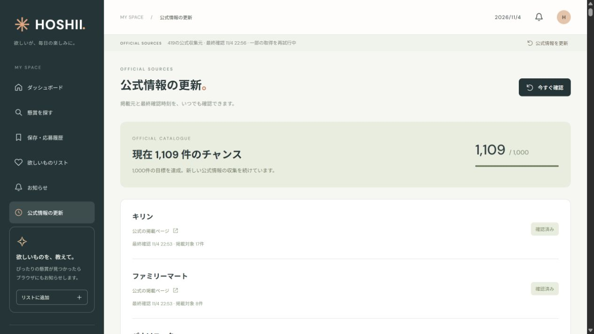

# HOSHII

**あなたの「欲しい」に、新しいチャンス。**

公式の懸賞・プレゼント情報を集め、欲しいものに合う新着を知らせるダッシュボードです。詳細検索、保存、応募履歴、サイト内通知、Web Pushに対応しています。



## できること

- 主催者・発行元・共同企画元の公式ページ、公開JSON/JSONP、主催者自身の公式発表からキャンペーン情報を収集
- ギフト券・デジタルギフト・ポイント・食品・家電・旅行・商品モニターを検索
- 購入条件、会員登録、応募方法、締切、当選人数による絞り込みと30件ごとのページ送り
- 欲しいものリストに合う新着を、サイト内お知らせとブラウザ通知で受信
- 保存・応募済み・既読状態をアカウントごとに保持
- 公式画像の出典表示と、表示できない場合のフォールバック

2026年11月4日の運用環境では、有効・重複なし **1,109件**、金券・ギフト系 **328件**、公式画像参照 **1,057件**を確認しました。件数は取得時点のもので、同梱データの掲載や応募の継続を保証するものではありません。更新時に公式情報と応募期間を再確認します。

## 技術構成

| 用途 | 技術 |
| --- | --- |
| UI | HTML / CSS / JavaScript |
| サーバー | TypeScript / Vinext / Cloudflare Workers |
| データ | Cloudflare D1 / Drizzle |
| 収集 | Cheerio / 公開JSON・JSONP |
| 通知 | Service Worker / Web Push / VAPID |
| テスト | Node.js test runner / SQLite |

## ローカル起動

Node.js **24** とnpmを使用します。

```sh
git clone https://github.com/yuumaokamori015710-droid/hoshii.git
cd hoshii
npm ci
npm run db:migrate:local
npm run dev -- --port 57831 --hostname 127.0.0.1
```

ブラウザで <http://127.0.0.1:57831/> を開き、「ChatGPTでログイン」から開発用のローカルアカウントへ進みます。ローカル認証はループバック接続に限定した開発用の仕組みです。「公式情報を更新」で、その時点で有効な情報を収集できます。初回は複数回の収集リクエストが実行されます。

ブラウザ通知を試す場合は `.dev.vars.example` を `.dev.vars` にコピーし、自分のVAPIDキーを設定してサーバーを再起動します。通知はブラウザ側でも許可する必要があります。

```sh
npm test
npm run build
```

## データと更新

- `lib/official-indexes.ts`：公式一覧・構造化データ・公式発表の収集と再確認
- `lib/expanded-catalog.json`：公式URL、出典、確認根拠を持つレビュー済みデータ
- `lib/catalog-identity.ts`：応募ID・ハッシュ経路を保つ重複排除
- `lib/live-store.ts`：永続化、掲載状態、欲しいものとの照合、通知
- `lib/push.ts` / `public/sw.js`：Web Push配信と受信
- `db/` / `drizzle/`：スキーマとマイグレーション

終了済み・開始前・通常の割引・同じ抽選の賞品違いを件数に含めません。不明な応募条件は推測せず、商品モニターのレビュー・写真・SNS投稿条件も保持します。キャンペーンへの応募は主催者の公式サイトで行います。

収集APIはカーソル付きの複数リクエストで更新します。運用方法は [OPERATIONS.md](OPERATIONS.md) を参照してください。このリポジトリを取得するだけでは、運用中の定期処理やデータベースは引き継がれません。

## 本番環境

現在のアプリは、Sitesが検証する認証ヘッダーとサービス認可、およびD1を前提にしています。GitHub Pages単体ではサーバーAPI・永続化・Web Push配信は動作しません。Cloudflare Workers等へ独立して配置する場合は、本人確認と更新APIの認可を実装し、クライアント由来の認証ヘッダーを信用しない構成にしてください。

`.openai/hosting.json` には開発用のバインディング宣言だけを含めています。Sitesに公開する場合は、自分のSiteを登録して発行された設定を使います。

## 公開範囲と権利

本番DB、利用者の欲しいもの・保存・応募履歴、プッシュ購読、VAPID秘密鍵、トークン、ローカル実行状態、非公開のGit履歴は含めていません。キャンペーン画像のファイルは同梱せず、公式掲載画像のURLと出典を参照します。各社の画像・ロゴ・商標・文章の権利は、それぞれの権利者に帰属します。画像の出典表示は利用許諾を示すものではありません。

このプロジェクト独自部分のライセンスは未設定です。第三者由来のファイルには、同梱のライセンス・著作権表記が適用されます。


### 応募条件の表示と収集方針

各懸賞のカード・詳細に、購入レシート、有料会員、銀行決済、テレビ応募番号等の具体条件と公式出典を表示します。検索は「追加条件なし／条件付き／未確認／すべて」を切り替えられます。通常のおすすめと新着通知は、公式規約を確認した追加条件なしの企画だけを対象にします。無料登録、SNSフォロー・リポスト、簡単なアンケートは対象に含めます。購入不要の記載だけで条件なしと推測しません。審査根拠は `lib/entry-reviews.json`、共通ポリシーは `lib/entry-conditions.ts` です。


公式審査の結果から、詳細画面で確認済みの応募フォーム・X投稿・LINE応募先へ進めます。条件が未確認から確認済みへ変わった既存企画も、欲しいものとの新しい一致として一度だけ通知します。公式発表で訂正した賞品別の終了日を優先し、期限切れを掲載件数に含めません。
